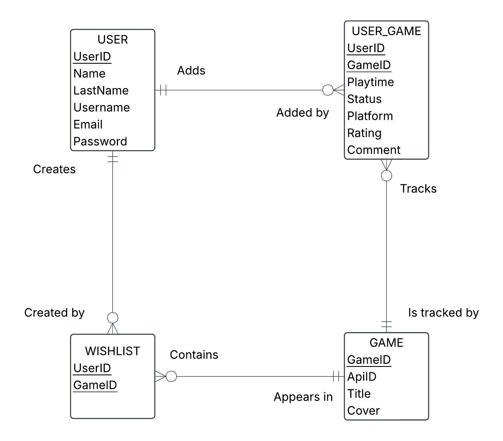
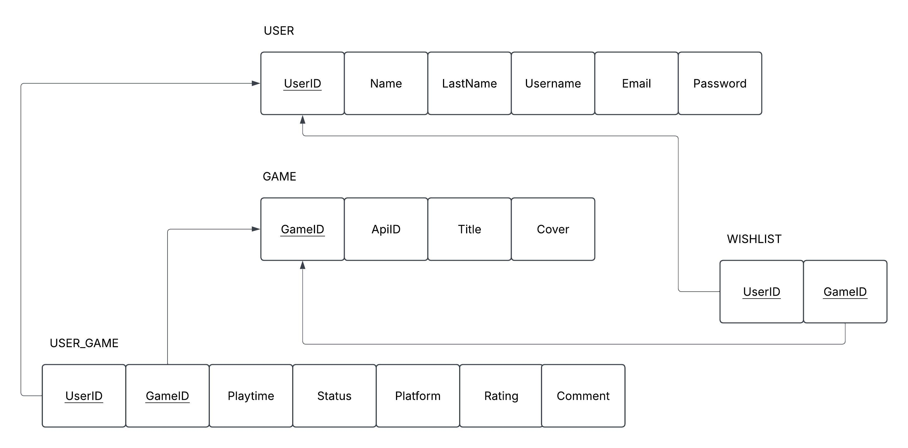
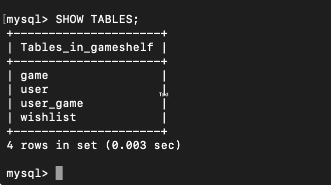

# GameShelf Web App
GameShelf is a web application born from my love of video games and 
my desire for a better way to keep track of the titles I own and play. 
The application's primary goal is to help gamers who use multiple platforms—such as 
Xbox, PlayStation, PC, or Nintendo—organize their games in one place. 
Instead of having to remember which games they own on each platform, 
users can create a personal library to add their games and their experiences with each one.

Each user can add a game to their library using a search bar which shows game results from an external API,
this API will provide the title of the game, an API id and the cover of the game, therefore the user will
provide their experience with each game such as, playtime, the platform they are playing on, status, personal 
ratings, and comments.
This allows users to track details of the games they own.
For instance, a user can mark a game as "Playing" while playing it and later switch the status to "Completed" upon finishing. 
They can also update playtime, ratings, or comments as they progress through the game.

The web application is also designed to help gamers who have limited free time or 
simply face an overwhelming number of choices. 
A large collection can make it difficult to decide what to play, 
especially when titles are spread across different platforms. 
By keeping everything organized in a single library, users can see what games they have available, 
track completed games, and decide which ones to prioritize. 

GameShelf will also feature a wishlist where users can list games 
they do not yet own but would like to buy or play in the future. 
Users will be able to search for their desired games through a search bar, 
same search bar used to add a game to their library.

This web application is designed for individual users; 
each user will have their own account, personal game library, and personal wishlist.
Users can create an account, log in, add games to their library, view and manage their games, 
update information on specific titles, remove games they no longer wish to keep, and maintain a separate wishlist. 
These would be the basic functions of the project for now, 
but I would like to enhance it further by adding different features over time.

## Business Rules
* A user may add zero or many user_game records.
* Each user_game record must belong to exactly one user.
* A game may appear in zero or many user_game records.
* Each user_game record must refer to exactly one game.
* A user may add zero or many games to their wishlist.
* Each wishlist record must belong to exactly one user.
* A game may appear in zero or many wishlist.
* Each wishlist record must refer to exactly one game.

The `ERD` bewlow illustrates the entities, their attributes, and their relationship between them.

The database relations below illustrates how the `user_game` and `wishlist` tables are related to the
`user` and `game` tables.

## Database Implementation
The GameShelf database was implemented using MySQL. It contains four tables, `user`, `game`, `user_game`, and `wishlist`.
The `user_game` table connects users to the games and stores personal experience about each game such as
`playtime`, `status`, `rating`, `comment`, and the `platform` they are playing on. The `wishlist` table connects users to
the games they want to acquire and play. Both tables references `user` and `game` tables trough foreign keys `user_id` and `game_id`, 
setting both keys as primary keys to prevent duplicate entries for the same user and game.
The database statements are avaliable in [schema.sql](schema.sql).

Below there is an output for `SHOW TABLES` confirming all four tables were succesfully created.

